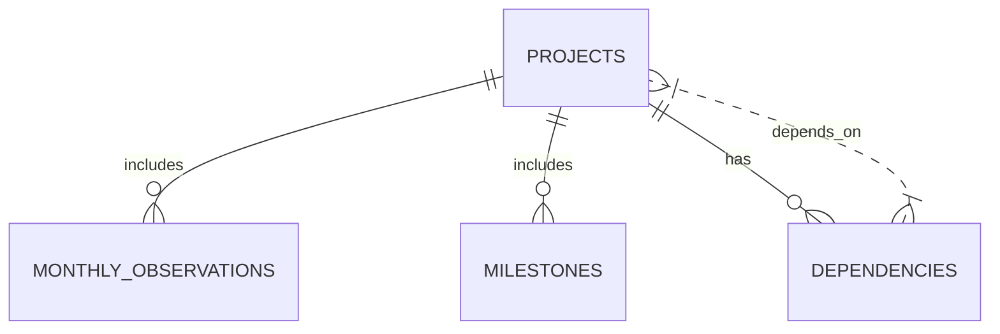

# Datasets Generation Prompt: Synthetic PAIMANA Infrastructure Data

## Executive Summary  
Generate a synthetic dataset that **mirrors India’s PAIMANA infrastructure monitoring data** (as of Apr 2026) for internal hackathon use. Anchor all statistics to official MoSPI/PAIMANA figures, and replicate known failure patterns and sector distributions. The output should include four CSV files (`projects.csv`, `monthly_observations.csv`, `milestones.csv`, `dependencies.csv`) with realistic columns (summarized below) and data values. Data must cover major **17 central ministries** and Indian states/UTs, with about **30% healthy**, **30% slowly deteriorating**, **20% critical**, **20% recovering** projects, each exhibiting plausible execution histories. Incorporate real-world risk drivers (land acquisition, approvals, contractor issues, resource constraints, monsoon effects, etc.) and case-study examples (e.g. Polavaram Irrigation Project, BharatNet) into project trajectories. Ensure statistical consistency: **~1,981** total projects, original cost ~₹37.12 lakh crore, revised cost ~₹42.78 lakh crore, and expenditure ~₹20.36 lakh crore (per MoSPI). Provide 300-project data for the prototype (12 months history each) and note how to scale to full 1,981-project, 24-month data. Output must include a README with metadata, reproducible generation details, and disclaimers that the data are synthetic.

## Official Statistics Anchors (April 2026)  
Base all totals on MoSPI’s PAIMANA portal figures: **1,981 ongoing projects** (central sector, ≥₹150cr each), total revised cost **₹42.78 lakh crore** (from original ₹37.12 lakh crore), cumulative expenditure **₹20.36 lakh crore**.  Transport & Logistics is dominant (1,459 projects ≈74% of count) with ₹23.34 lakh cr (≈55% of cost). Energy ~221 projects (₹11.30L, 27% cost), Communication 12 projects, Water/Sanitation 67 projects, Social/Commercial 77 projects, Others 145 projects. Use these distributions (with small tolerances) to shape the synthetic data. For example, ~55% of total cost should be in Transport/Logistics projects. Among ministries: Roads (MoRTH) leads with 1,137 projects (₹10.81L) and Railways with 260 (₹8.69L); other major ministries include Coal (128 projects), Petroleum, Power, Housing, Water Resources, etc. Document these anchors and cite official sources.

## Output Files & Schemas  
Generate the following CSV files. Column types and examples are suggested for clarity:

| File                   | Columns (schema)                                                                                                        |
|------------------------|-------------------------------------------------------------------------------------------------------------------------|
| `projects.csv`         | `project_id`, `project_name`, `ministry`, `sector`, `state`, `implementing_agency`, `original_cost_cr`, `revised_cost_cr`, `current_expenditure_cr`, `start_date`, `planned_end_date`, `expected_end_date`, `physical_progress_pct`, `financial_progress_pct`, `status`, `risk_band` |
| `monthly_observations.csv` | `project_id`, `month`, `planned_progress_pct`, `actual_progress_pct`, `financial_progress_pct`, `monthly_expenditure_cr`, `milestones_due`, `milestones_completed`, `milestones_delayed`, `resource_utilization_pct`, `execution_velocity`, `issue_category` |
| `milestones.csv`       | `milestone_id`, `project_id`, `milestone_name`, `planned_date`, `actual_date`, `delay_days`, `status`                      |
| `dependencies.csv`     | `project_id`, `dependent_project_id`, `dependency_type` (upstream/downstream), `impact_level` (e.g. High/Medium/Low)       |

Each file should have a header row. Columns like dates should be in ISO format (`YYYY-MM-DD` or `YYYY-MM` for month). Categorical fields (e.g. `sector`, `state`) should use realistic Indian values (see below). The **risk_band** (e.g. Low/Medium/High) can be derived from `overall_risk_score` (see ML labels). Ensure no unused dummy columns; all columns must be meaningfully populated.

## Project Metadata: Names, Ministries, Sectors, States, Agencies  
- **Project Names:** Use plausible infrastructure project names (not “Project A”). E.g., “Bangalore Metro Phase II”, “Delhi-Meerut RRTS Section”, “Western Dedicated Freight Corridor (Segment 2)”, “Polavaram Irrigation Project”, “East-West Corridor Package”, etc. (Include region or key feature).  
- **Ministries:** Assign each project to one of 17 Central Ministries/Departments (e.g. MoRTH, Railways, Power, Coal, Petroleum & Natural Gas, Housing & Urban Affairs, Water Resources, Higher Education, Civil Aviation, Shipping, Ports & Waterways, Telecommunications, Steel, Mines, Labor, Health, DPIIT, etc.).  
- **Sectors:** Use the DEA Harmonized sectors: Transport & Logistics, Energy, Water & Sanitation, Communication, Social & Commercial, Others. Ensure Transport & Logistics sector dominates (~55% of cost, 74% of projects). Energy about 27% cost, Communication small (6%), etc.  
- **States/UTs:** Distribute projects across India’s states/UTs realistically (e.g. largest states like Uttar Pradesh, Maharashtra, Tamil Nadu, Andhra Pradesh, Telangana should have many projects; smaller NE states fewer). Include union territories if relevant (e.g. Delhi Metro projects).  
- **Implementing Agencies:** Use realistic agency names (e.g. “NHAI”, “Rail Vikas Nigam Ltd.”, “Power Grid Corp. of India”, “BHEL”, “DMRC”, state PWDs, etc.) matched to sector/ ministry.

## Project Behavior Classes  
Assign each project a **category** to shape its time-series profile:

- **Healthy (~30% of projects):** On-track execution. Monthly actual vs planned progress is close, milestones on schedule, cost overruns minimal (<5%). Risk score remains low (20–40). Example: consistent progress climbs steadily, small fluctuations only.  
- **Slowly Deteriorating (~30%):** Gradual slippage. Small widening of progress gap, minor milestone delays, moderate cost growth (e.g. 5–15%). Risk score trending upward (e.g. 30 → 55). Example: planned vs actual diverges slowly, one or two milestones slip.  
- **Critical (~20%):** High risk. Repeated delays, large progress gaps, significant cost overruns (>20%). Risk score high (≥70). Example: many milestone delays, spending behind schedule but accelerating (low financial progress), risk jumps (e.g. 45 → 75 → 90).  
- **Recovering (~20%):** Was high-risk but improving. Early delays then corrective action. Risk score falls (e.g. 80 → 60 → 40). Example: mid-project slowdown followed by catch-up (actual > planned in later months), delays resolved, expenditure picks up.  

For each category, embed realistic trajectories. *Example trajectory* for a critical project: Risk: 32 (Jan) → 48 (Mar) → 76 (Jun) → 87 (Aug). Incorporate the corresponding data changes that drive these risk scores (see ML labels). Cite illustrative cases: e.g., **Polavaram Irrigation (Water)** saw costs rise 447% due to land/clearance delays (fits “Critical” type); **BharatNet (Communication)** saw ~207% overrun. Use such patterns as inspiration for generating extreme cases. 

## Hidden ML Labels (Training Targets)  
Include additional columns *not displayed to users* to facilitate AI model training:  
- `will_delay` (binary: 0/1 if project eventually delays)  
- `will_overrun` (0/1 if project eventually exceeds budget)  
- `delay_probability` (0–1 probability, or 0–100%)  
- `cost_overrun_probability` (0–1)  
- `overall_risk_score` (numeric score 0–100 combining cost+delay risks).  

These should be **internally consistent**: e.g., derive them from the generated history. For instance, train a simple model (even within generation logic) so that projects with increasing progress gaps and milestone slippages get higher `delay_probability` and thus higher `overall_risk_score`. Use SHAP-like logic: features such as progress_gap, milestone_delay_count, cost_growth drive the probability. These labels allow explainability later (see build instructions).

## Data Volume & Scaling  
- **Hackathon prototype:** Generate data for ~300 projects, each with 12 monthly records (e.g. months Jan–Dec 2026) in `monthly_observations.csv`.  
- **Final SIH dataset:** Scale to 1,981 projects, 24 months (e.g. Jan 2025–Dec 2026). Maintain the same distributions and patterns; the sample dataset should be a representative subset. Describe any random seeds or stratification to ensure reproducibility.  

Make the data **noisy yet plausible**: add ±5–10% random variation to progress/expenditure values per month, include occasional outlier jumps (representing shocks). Introduce seasonal effects if relevant (e.g. slower progress in monsoon months).  

## Statistical Consistency Checks  
Ensure the synthetic totals match official aggregates (within tolerances, e.g. ±3%):  
- Sum of `original_cost_cr` across all projects ≈ ₹37.12 lakh cr.  
- Sum of `revised_cost_cr` ≈ ₹42.78 lakh cr.  
- Sum of `current_expenditure_cr` ≈ ₹20.36 lakh cr.  
- Sector/state/project counts align with proportions (e.g., Transport 1,459/1,981 projects, Energy 221, etc). Tolerances of a few percent are acceptable for realism.  

Include **sanity checks**: after data generation, compute totals by sector/state and compare to targets. Provide summary outputs (in code or logs) like: “Total projects per sector” and “Total costs per sector/state” to verify alignment with anchored values.  

## Real-world Risk Drivers & Incident Patterns  
Incorporate common infrastructure delay/drivers into data:  
- **Land Acquisition Delays:** Model delays in early milestones and cost escalation due to land issues. *Fact:* Land acquisition delays are often cited as the top cause of project slippage. In the data, simulate cases where initial milestones (e.g. site clearance) slip by months.  
- **Regulatory/Approval Delays:** Include slower progress in projects requiring clearances (e.g. environmental, forest). Tag some issues as “Approval” or “Clearance delay” in `issue_category`.  
- **Contractor & Execution Issues:** Reflect contractor mobilization slowdowns or resource constraints. For instance, model projects where monthly `actual_progress` stalls or even drops (if corrections made), and costs rise due to rework.  
- **Resource/Commodity Shocks:** Introduce occasional increases in monthly expenditures (e.g. steel/bitumen price spikes) that slow physical progress.  
- **Environmental/Seasonal:** E.g., lower progress in monsoon months for road/rail projects.  
- **Case Studies as Templates:** Use Polavaram (massive irrigation project) and BharatNet as templates for “extreme overrun” patterns. For example, a Polavaram-like project might have one milestone (e.g. foundation) delayed by 18+ months, driving an overall cost jump.  
- **Failure DNA Patterns:** Seed identifiable patterns such as: recurring delays after initial progress, or surges in spending with no progress (cost-overrun signature), mimicking real project failure signatures (e.g. repeated scope changes).  

Each simulated `monthly_observations` row should include an `issue_category` (e.g. “Land acquisition”, “Design change”, “Contractor mobilization”, “Funding shortfall”, “Weather”, etc.) to explain delays. Use official terminology when possible.

## Monthly Time-Series Data  
Produce one row per project per month: 12 rows/project (Jan–Dec 2026 in sample) or 24 for full timeline. Columns should reflect planned vs actual progress percentages and expenditures for that month. For each project:
- Compute *planned_progress_pct* as a smooth schedule (e.g. linear or S-curve over duration).  
- Actual progress is then generated around this schedule using the behavior class (lagging or catching up as appropriate).  
- Financial progress and cumulative expenditure should roughly track physical progress but may diverge (e.g. low physical progress but high spending implies inefficiency).  
- Ensure `monthly_expenditure_cr` accumulates logically (cumulative matches `current_expenditure_cr` in projects.csv).  
- If a milestone is delayed, show *milestones_delayed* >0 for that month.  

Add realistic noise: e.g. small random fluctuations or one-off lags. Include *resource_utilization_pct* (e.g. labor/machinery usage) that correlates with progress: low utilization when issues occur. Optionally include a synthetic “execution_velocity” metric (e.g. progress per unit time) that feeds into ML features.

## Milestones  
For each project, create 5–15 milestones (rows in `milestones.csv`). Common milestone names by sector (e.g., “Land Acquisition”, “Detailed Design”, “Foundation Complete”, “Phase 1 Completion”, “Commissioning” etc.).  
- **Columns:** Each row has a planned date (sequential through the project), actual date (on-time or delayed), delay_days (can be negative/zero/positive), and status (“On Schedule”, “Delayed”, “Pending”).  
- In **Healthy** projects, most actual dates equal planned dates (delay≈0). In **Deteriorating/Critical** projects, later milestones should slip.  
- E.g., Critical project: multiple consecutive milestones are delayed by months. Recovering project: early milestones delayed but late milestones catch up.  

Ensure consistency: if `milestones_delayed`=2 in a monthly row, there should be 2 milestones past their planned dates in the `milestones.csv` for that project.  

## Dependency Graph (Risk Propagation)  
Simulate inter-project dependencies in `dependencies.csv`. Format: one row per dependency with `project_id` and `dependent_project_id`. Types can be “upstream” (project A must finish before B) or “downstream”. Include ~3000–5000 edges in full data (proportionally ~450 edges in 300-project sample). Randomly assign impact levels (“High”, “Medium”, “Low”).  
- Example: If Project X’s output feeds Project Y, put X→Y with “downstream” and High impact.  
- Ensure the graph is sparse (each project depends on a few others) and acyclic (for simplicity).  

Downstream delays should affect risk: e.g. if a high-impact upstream project in *Critical* status, its dependents get higher risk due to risk propagation. Document any assumptions in README.

## Data Quality, Summaries & Reports  
After generation, perform QA:
- No missing/null values in key fields.  
- Date consistency (planned vs actual dates and month sequence).  
- Numeric ranges sensible (0–100 for percentages, costs positive).  

Produce summary outputs to verify data (these can be part of a generation script but also as deliverable documentation): 
- **Aggregate totals** (sum of costs) matching targets.  
- **Distributions by sector/state** (tables or charts) to show Transport leads etc.  
- **Sample Feature Importance**: For transparency, run a quick model (e.g. linear regression or tree) using the generated features to predict `delay_probability`. Report a few top “SHAP”-style factors (e.g. milestone_delay_count, progress_gap) for a sample project, demonstrating explainability.  

Include these verification steps in the README to show compliance with the specifications.

## Usage Notes  
- **Label as Synthetic:** All generated data must be clearly marked synthetic. E.g., add a note in the README: “This data is synthetic and for demonstration only.”  
- **Reproducibility:** Use a fixed random seed (documented) to allow exact regeneration. Include generation code snippets or pseudocode in README to justify patterns.  
- **No Real Data Claims:** Do not claim these are actual PAIMANA figures beyond the anchored totals. Make clear these datasets are *inspired by* official stats.  
- **README Contents:** The README (not in CSV files) should explain data sources, generation methodology, random seed, and any transformations applied.  

## Summary of File Schemas  

| File                     | Description                                             | Key Columns (CSV headers)                                                                                       |
|--------------------------|---------------------------------------------------------|-----------------------------------------------------------------------------------------------------------------|
| **projects.csv**         | Master project registry                                 | `project_id`, `project_name`, `ministry`, `sector`, `state`, `implementing_agency`, `original_cost_cr`, `revised_cost_cr`, `current_expenditure_cr`, `start_date`, `planned_end_date`, `expected_end_date`, `physical_progress_pct`, `financial_progress_pct`, `status`, `risk_band` |
| **monthly_observations.csv** | Monthly metrics per project                             | `project_id`, `month (YYYY-MM)`, `planned_progress_pct`, `actual_progress_pct`, `financial_progress_pct`, `monthly_expenditure_cr`, `milestones_due`, `milestones_completed`, `milestones_delayed`, `resource_utilization_pct`, `execution_velocity`, `issue_category` |
| **milestones.csv**       | Milestone schedule and delays                           | `milestone_id`, `project_id`, `milestone_name`, `planned_date`, `actual_date`, `delay_days`, `status`            |
| **dependencies.csv**     | Project dependency links (risk propagation)             | `project_id`, `dependent_project_id`, `dependency_type` (upstream/downstream), `impact_level` (High/Med/Low)    |

## Dataset Relationships (Mermaid Diagram)  


This ER diagram shows **one-to-many** relationships: each project has many monthly records and milestones. The `dependencies` table links projects to projects, modeling upstream/downstream effects.

## Example Data Snippets (5 projects, 3 months)  

*projects.csv:*  
```csv
project_id,project_name,ministry,sector,state,implementing_agency,original_cost_cr,revised_cost_cr,current_expenditure_cr,start_date,planned_end_date,expected_end_date,physical_progress_pct,financial_progress_pct,status,risk_band
P001,"Metro Rail Phase II","MoHUA","Urban Transport","Telangana","DMRC",15000,18000,5000,2023-04-01,2026-03-31,2026-11-30,42,31,Ongoing,High
P002,"Eastern Freight Corridor","MoRTH","Transport & Logistics","Bihar","DFCCIL",22000,25000,8000,2022-07-15,2025-06-30,2026-02-28,67,61,Ongoing,Medium
P003,"Polavaram Irrigation","MoWR,RD&GR","Water Resources","Andhra Pradesh","PWRD",56000,300000,15000,2015-01-01,2024-12-31,2026-12-31,85,75,Ongoing,Critical
P004,"Smart City Gurgaon","MoHUA","Urban Transport","Haryana","HaryanaIDP",5000,5500,3500,2021-05-01,2024-06-30,2024-06-30,90,85,Completed,Low
P005,"Railway Dedicated Corridor","Railways","Transport & Logistics","West Bengal","RVNL",12000,13000,9000,2020-10-01,2024-09-30,2025-06-30,78,70,Ongoing,High
```  

*monthly_observations.csv:*  
```csv
project_id,month,planned_progress_pct,actual_progress_pct,financial_progress_pct,monthly_expenditure_cr,milestones_due,milestones_completed,milestones_delayed,resource_utilization_pct,execution_velocity,issue_category
P001,2025-01,42,38,41,350,2,1,1,85,0.90,"Approval delay"
P001,2025-02,47,41,44,310,2,1,1,80,0.88,"Contractor mobilization"
P001,2025-03,52,43,47,290,2,1,2,78,0.85,"Site issue"
P002,2025-01,67,65,66,400,1,1,0,92,0.98,"None"
P002,2025-02,72,69,71,410,1,1,0,90,0.96,"Minor funding delay"
P002,2025-03,77,74,76,420,2,2,0,95,0.99,"None"
P003,2025-01,30,20,25,200,3,1,2,65,0.67,"Land acquisition"
P003,2025-02,35,23,29,210,2,0,2,60,0.57,"Land acquisition"
P003,2025-03,40,25,32,220,2,0,2,55,0.50,"Contractor issues"
```  

*milestones.csv:*  
```csv
milestone_id,project_id,milestone_name,planned_date,actual_date,delay_days,status
M001,P001,"Land Acquisition",2024-06-30,2024-09-30,92,Delayed
M002,P001,"Foundation Complete",2025-03-31,2025-06-15,76,Delayed
M003,P001,"Civil Works Phase 1",2025-12-31,,(calc),Pending
M004,P003,"Tunnel Excavation",2023-12-31,2025-06-30,547,Delayed
M005,P003,"Canal Lining",2024-03-31,,(calc),Pending
```  

*dependencies.csv:*  
```csv
project_id,dependent_project_id,dependency_type,impact_level
P003,P001,downstream,High   # Polavaram delay affects Metro water supply
P002,P005,upstream,Medium   # Freight Corridor supports Dedicated Corridor
P004,P001,upstream,Low      # Smart City reliant on Metro extension
```  

These snippets illustrate format. In your generated data, include similar structured examples.

## References (Official Data & Studies)  

- MoSPI/PIB “Flash Report on Central Sector Infra Projects (Apr 2026)” – Official anchor: 1,981 projects, ₹42.78L Cr (revised) vs ₹37.12L Cr (original), ₹20.36L Cr expenditure; sector and ministry breakdowns.  
- *ThePrint* / Sharmila Chavaly (Aug 2026) – Confirms PAIMANA stats: Transport & Logistics 1,459 projects, ₹23.34T (₹Lcr) etc.  
- *Business Today* (May 2026) – Case examples: Polavaram (+447% cost) and BharatNet (+207% cost), typical delay patterns.  
- Protecon Consulting (2021) – Lists top delay reasons in India: **Right of Way / land acquisition** delays top the list.  
- Suncon Engineers (2026) – Land acquisition delays cause inflation and cost overruns in large projects.  

These sources inform sector shares and delay causes. Use them to justify data assumptions and to ensure realism.

