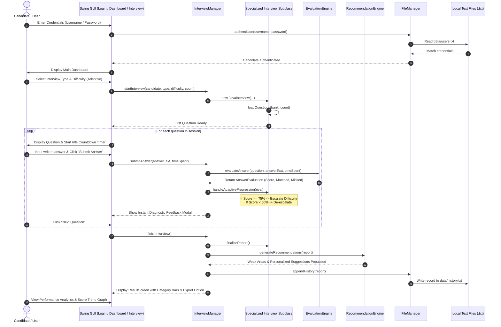

# AI Interview Simulator – Intelligent Mock Interview & Evaluation System

**Course:** Object-Oriented Programming through Java (B.Tech 2nd Year Mini-Project)  
**Academic Year:** 2025–2026  
**Technology:** 100% Pure Java (JDK 21 LTS, Java Swing, Java Collections, Java File I/O)  
**Architecture:** Object-Oriented Architecture (Encapsulation, Inheritance, Abstraction, Polymorphism, Interfaces)  

---

## Table of Contents
1. [Project Title](#1-project-title)
2. [Abstract](#2-abstract)
3. [Problem Statement](#3-problem-statement)
4. [Objectives](#4-objectives)
5. [Scope](#5-scope)
6. [Technology Stack](#6-technology-stack)
7. [System Architecture](#7-system-architecture)
8. [OOP Concepts Used](#8-oop-concepts-used)
9. [Class Diagram](#9-class-diagram)
10. [Workflow Diagram](#10-workflow-diagram)
11. [GUI Screens Description](#11-gui-screens-description)
12. [Module Description](#12-module-description)
13. [Algorithms Used](#13-algorithms-used)
14. [File Handling Details](#14-file-handling-details)
15. [Future Enhancements](#15-future-enhancements)
16. [Advantages](#16-advantages)
17. [Conclusion](#17-conclusion)
18. [Viva One-Liner & Comprehensive Viva Q&A Guide](#18-viva-one-liner--comprehensive-viva-qa-guide)

---

## 1. Project Title

**AI Interview Simulator – Intelligent Mock Interview & Evaluation System**

---

## 2. Abstract

In contemporary campus placement and engineering recruitment drives, candidates frequently face rigorous interview evaluation across behavioral (HR), foundational programming (Java), and data persistence (DBMS) disciplines. Many technically proficient candidates fail to secure employment due to a lack of practice in articulating conceptual terminology, poor time management under countdown pressure, and an absence of targeted feedback identifying technical gaps.

The **AI Interview Simulator** is a standalone, offline, high-performance desktop application engineered strictly using **pure Java** and **Java Swing**. The system eliminates all external cloud APIs, heavy machine learning libraries, web servers, and third-party relational databases, utilizing standard **Java File I/O** for persistent data management. 

Featuring an intelligent **Keyword-Matching Evaluation Engine**, a **Real-Time 60-Second Countdown Timer**, **Dynamic Adaptive Difficulty Progression** (Easy → Medium → Hard based on live candidate performance), and a **Diagnostic Recommendation Engine**, the system emulates real-world interview panels. Candidates receive comprehensive performance analytics, category-wise mastery graphs rendered via custom Java 2D Graphics, and personalized study roadmaps to bridge conceptual gaps prior to live corporate recruitment.

---

## 3. Problem Statement

Undergraduate engineering students preparing for technical placements face three primary impediments:
1. **Lack of Practice Under Realistic Pressure:** Traditional preparation relies on passive reading or static multiple-choice questions (MCQs), which fail to train candidates to synthesize written and verbal technical explanations within a strict 60-second window.
2. **Inaccessibility of Immediate, Objective Feedback:** Peer mock interviews are subjective, resource-intensive, and inconsistent. Commercial AI interview platforms require paid subscriptions, stable internet connectivity, and external server infrastructures.
3. **Absence of Weak-Topic Diagnostics:** Candidates often know their final interview outcome (selected/rejected) but receive no granular diagnostic insight into whether their weakness lies in OOP pillars, concurrency, SQL normalization, or behavioral communication.

The **AI Interview Simulator** addresses these challenges by delivering an offline, accessible, deterministic, and educational mock interview platform.

---

## 4. Objectives

The primary objectives of this mini-project are:
- **Simulate Real Placement Rounds:** Support specialized interview rounds for HR Behavioral, Core Java Technical, DBMS Technical, and Comprehensive Mixed tracks.
- **Implement Intelligent Answer Evaluation:** Evaluate free-text candidate answers using case-insensitive tokenization, stop-word elimination, stem heuristics, and keyword coverage scoring without external libraries.
- **Implement Real-Time Countdown Constraints:** Enforce a 60-second countdown timer per question using `javax.swing.Timer` with dynamic color feedback (Green → Amber → Red) and automated submission upon timeout.
- **Incorporate Dynamic Adaptive Progression:** Automatically adjust subsequent question difficulty based on real-time candidate scores:
  $$\text{Score} \ge 75\% \implies \text{Difficulty Escalation (Easy} \to \text{Medium} \to \text{Hard)}$$
  $$\text{Score} < 50\% \implies \text{Foundational De-escalation}$$
- **Deliver Personalized Diagnostic Recommendations:** Flag weak categories (scores $< 65\%$) and compile a targeted revision roadmap based on missed technical terminology.
- **Demonstrate Core Object-Oriented Principles:** Exemplify Encapsulation, Inheritance, Abstraction, Polymorphism, and Interfaces in an enterprise-grade architecture.
- **Persist Data Using Java Text File I/O:** Store user credentials, question repositories, and session histories in pipe-delimited text files (`.txt`).

---

## 5. Scope

### In Scope
- Offline desktop deployment using standard Java Runtime Environment (JRE 21+).
- Candidate registration, credential storage, and session authentication with custom `InvalidLoginException`.
- Curated question bank with 24+ questions across HR, Java, and DBMS with three difficulty tiers (Easy, Medium, Hard).
- Free-form text input area with live character and word counters.
- Instant per-question feedback modals detailing matched keywords, missed concepts, and score percentages.
- Final summary dashboard featuring overall percentage, grade badges (A+, A, B, C), accuracy ratios, and category mastery progress bars.
- Printable/exportable `.txt` performance report cards.
- Custom Java 2D Graphics visualizer displaying subject mastery horizontal bars and historical score trend charts.

### Out of Scope (By Design & Project Constraints)
- Third-party SQL/NoSQL database systems (e.g., MySQL, MongoDB).
- External web servers, cloud APIs, HTML/CSS, JavaScript, or Python.
- External heavy ML/NLP libraries (e.g., PyTorch, spaCy, Stanford NLP).

---

## 6. Technology Stack

| Layer | Technology | Description |
| :--- | :--- | :--- |
| **Programming Language** | Java (JDK 21 LTS) | 100% pure Java implementation |
| **Graphical User Interface (GUI)** | Java Swing (`javax.swing.*`) | Pure desktop GUI with modern dark-slate aesthetic |
| **Graphics Engine** | Java AWT (`java.awt.*`, `Graphics2D`) | Custom anti-aliased charts, meters, and progress tracks |
| **Data Persistence** | Java File I/O (`java.io.*`) | `BufferedReader`, `BufferedWriter`, `FileReader`, `FileWriter` |
| **Data Structures** | Java Collections Framework | `ArrayList`, `HashMap`, `HashSet`, `List`, `Map`, `Set` |
| **Concurrency & Timing** | `javax.swing.Timer` | Event-driven 1-second interval countdown |
| **Operating System** | Platform Independent | Windows, Linux, macOS compatible |

---

## 7. System Architecture

The project follows a clean **Model-View-Service-Utility (MVSU)** layered architecture:

```mermaid
graph TD
    subgraph UI_Layer [GUI Presentation Layer - javax.swing]
        LoginScreen[LoginScreen]
        MainDashboard[MainDashboard]
        InterviewSetupScreen[InterviewSetupScreen]
        InterviewScreen[InterviewScreen]
        ResultScreen[ResultScreen]
        HistoryScreen[HistoryScreen]
        AnalyticsScreen[AnalyticsScreen]
    end

    subgraph Service_Layer [Service & Business Logic Layer]
        InterviewManager[InterviewManager]
        EvaluatorInterface["<< interface >>\nEvaluator"]
        EvaluationEngine[EvaluationEngine]
        RecommendationEngine[RecommendationEngine]
        ReportGenerator[ReportGenerator]
    end

    subgraph Model_Layer [Domain Models - OOP Hierarchy]
        Candidate[Candidate]
        Question[Question]
        AnswerEvaluation[AnswerEvaluation]
        InterviewSessionReport[InterviewSessionReport]
        AbstractInterview["<< abstract >>\nInterview"]
        HRInterview[HRInterview]
        JavaInterview[JavaInterview]
        DBMSInterview[DBMSInterview]
        MixedInterview[MixedInterview]
    end

    subgraph Persistence_Layer [Persistence & Utility Layer]
        FileManager[FileManager]
        CustomExceptions[InvalidLoginException\nEmptyAnswerException\nFileReadException]
        UITheme[UITheme]
        TextFiles[(Text Files:\nquestions.txt\nusers.txt\nhistory.txt)]
    end

    LoginScreen --> FileManager
    MainDashboard --> InterviewManager
    InterviewSetupScreen --> InterviewManager
    InterviewScreen --> InterviewManager
    ResultScreen --> ReportGenerator
    AnalyticsScreen --> FileManager

    InterviewManager --> EvaluatorInterface
    EvaluationEngine ..|> EvaluatorInterface
    InterviewManager --> RecommendationEngine
    InterviewManager --> ReportGenerator
    InterviewManager --> AbstractInterview

    AbstractInterview <|-- HRInterview
    AbstractInterview <|-- JavaInterview
    AbstractInterview <|-- DBMSInterview
    AbstractInterview <|-- MixedInterview

    AbstractInterview --> Candidate
    AbstractInterview --> Question
    AbstractInterview --> InterviewSessionReport
    InterviewSessionReport --> AnswerEvaluation

    InterviewManager --> FileManager
    FileManager --> TextFiles
```

---

## 8. OOP Concepts Used

The system is designed as an academic showcase of the five fundamental pillars of Object-Oriented Programming:

### 1. Encapsulation
Encapsulation binds data variables and the methods manipulating them within a single unit while restricting direct unauthorized access.
- All model classes (`Candidate`, `Question`, `AnswerEvaluation`, `InterviewSessionReport`) declare internal state as `private`.
- Public getter and setter methods enforce validation (e.g., scores clamped between $0$ and $100$, non-null string parsing).

```java
public class Candidate {
    private String name;
    private String rollNumber;
    private String branch;
    private String username;
    private String password;
    private List<InterviewSessionReport> interviewHistory;

    public String getName() { return name; }
    public void setName(String name) { this.name = name; }
    // Full accessors and mutators...
}
```

### 2. Abstraction
Abstraction hides low-level implementation details and presents only essential interfaces.
- `Interview` is defined as an `abstract class`. It defines the template workflow for any interview session (`nextQuestion()`, `recordAnswer()`, `handleAdaptiveProgression()`), while deferring specialized logic (`getInterviewType()`, `getPassingThreshold()`, `loadQuestions()`) to subclasses.

```java
public abstract class Interview {
    protected Candidate candidate;
    protected List<Question> questions;
    
    public abstract String getInterviewType();
    public abstract int getPassingThreshold();
    public abstract void loadQuestions(List<Question> questionBank, int maxQuestions);
}
```

### 3. Inheritance
Inheritance promotes code reusability by allowing specialized subclasses to inherit behavior and attributes from a common ancestor.
- `HRInterview`, `JavaInterview`, `DBMSInterview`, and `MixedInterview` all extend `abstract class Interview`.
- Subclasses inherit common session management, question indexing, and reporting logic without code duplication.

```java
public class JavaInterview extends Interview {
    public JavaInterview(Candidate candidate, String selectedDifficulty) {
        super(candidate, selectedDifficulty);
    }

    @Override
    public String getInterviewType() {
        return "Java Technical Round";
    }

    @Override
    public int getPassingThreshold() {
        return 70; // 70% passing threshold for Java Technical
    }
    // Subclass-specific question filtering...
}
```

### 4. Polymorphism
Polymorphism allows objects of different concrete types to be manipulated through a unified parent reference, with dynamic method dispatch invoking the appropriate subclass behavior at runtime.
- The `InterviewManager` references `Interview currentInterview` polymorphically. When invoking `currentInterview.loadQuestions(...)` or `currentInterview.getInterviewType()`, Java executes the specific subclass implementation at runtime.

```java
Interview interview;
if (type.equalsIgnoreCase("HR")) {
    interview = new HRInterview(candidate, difficulty);
} else if (type.equalsIgnoreCase("DBMS")) {
    interview = new DBMSInterview(candidate, difficulty);
} else if (type.equalsIgnoreCase("Mixed")) {
    interview = new MixedInterview(candidate, difficulty);
} else {
    interview = new JavaInterview(candidate, difficulty);
}
// Runtime Polymorphism: Dynamic method dispatch
interview.loadQuestions(questionBank, numQuestions);
```

### 5. Interfaces
An interface establishes a formal behavioral contract that implementing classes must satisfy.
- `interface Evaluator` defines the answer evaluation contract.
- `EvaluationEngine` implements `Evaluator`, decoupling the evaluation algorithm from GUI controllers and allowing alternative evaluators (e.g., Levenshtein distance, regex matcher) to be plugged in seamlessly.

```java
public interface Evaluator {
    AnswerEvaluation evaluateAnswer(Question question, String answerText, int timeElapsedSeconds) 
            throws EmptyAnswerException;
}

public class EvaluationEngine implements Evaluator {
    @Override
    public AnswerEvaluation evaluateAnswer(Question question, String answerText, int timeElapsedSeconds) 
            throws EmptyAnswerException {
        // Keyword matching and tokenization logic
    }
}
```

---

## 9. Class Diagram

```mermaid
classDiagram
    class Candidate {
        -String name
        -String rollNumber
        -String branch
        -String username
        -String password
        -List~InterviewSessionReport~ interviewHistory
        +getName() String
        +getAverageScore() double
        +getBestScore() int
        +toPipeDelimited() String
    }

    class Question {
        -int questionId
        -String category
        -String difficulty
        -String questionText
        -List~String~ keywords
        -String sampleIdealAnswer
        +getQuestionText() String
        +getKeywords() List~String~
        +toPipeDelimited() String
    }

    class Evaluator {
        <<interface>>
        +evaluateAnswer(Question q, String ans, int time) AnswerEvaluation
    }

    class EvaluationEngine {
        -Set~String~ STOP_WORDS
        +evaluateAnswer(Question q, String ans, int time) AnswerEvaluation
    }
    Evaluator <|.. EvaluationEngine

    class Interview {
        <<abstract>>
        #Candidate candidate
        #String selectedDifficulty
        #String currentDifficulty
        #List~Question~ questions
        #int currentIndex
        #InterviewSessionReport report
        +getInterviewType()* String
        +getPassingThreshold()* int
        +loadQuestions(List~Question~ bank, int max)* void
        +hasNextQuestion() boolean
        +getCurrentQuestion() Question
        +handleAdaptiveProgression(AnswerEvaluation eval, List~Question~ bank) void
        +finalizeReport() InterviewSessionReport
    }

    class HRInterview {
        +getInterviewType() String
        +getPassingThreshold() int
        +loadQuestions(List~Question~ bank, int max) void
    }
    class JavaInterview {
        +getInterviewType() String
        +getPassingThreshold() int
        +loadQuestions(List~Question~ bank, int max) void
    }
    class DBMSInterview {
        +getInterviewType() String
        +getPassingThreshold() int
        +loadQuestions(List~Question~ bank, int max) void
    }
    class MixedInterview {
        +getInterviewType() String
        +getPassingThreshold() int
        +loadQuestions(List~Question~ bank, int max) void
    }

    Interview <|-- HRInterview
    Interview <|-- JavaInterview
    Interview <|-- DBMSInterview
    Interview <|-- MixedInterview

    class AnswerEvaluation {
        -Question question
        -String candidateAnswer
        -List~String~ matchedKeywords
        -List~String~ missedKeywords
        -int score
        -int timeTakenSeconds
        -String feedback
        +isPassed() boolean
        +getScore() int
    }

    class InterviewSessionReport {
        -String recordId
        -String username
        -String timestamp
        -String interviewType
        -int totalScorePercentage
        -Map~String, Integer~ categoryScores
        -List~String~ weakAreas
        -List~String~ suggestions
        +computeAggregates() void
        +toHistoryLine() String
    }

    class FileManager {
        -File questionsFile
        -File usersFile
        -File historyFile
        +loadQuestions() List~Question~
        +authenticate(String user, String pass) Candidate
        +registerUser(Candidate c) boolean
        +loadHistory(String user) List~InterviewSessionReport~
        +appendHistory(InterviewSessionReport r) boolean
    }

    Interview --> Candidate
    Interview --> Question
    Interview --> InterviewSessionReport
    InterviewSessionReport --> AnswerEvaluation
```



---

## 10. Workflow Diagram



---

## 11. GUI Screens Description

The graphical interface is styled with a modern dark-slate theme (`#0F172A`), card layouts (`#1E293B`), and vibrant accent highlights (`#38BDF8`, `#10B981`, `#F59E0B`, `#EF4444`).

| Screen | Title / Window | Components & Functionality |
| :--- | :--- | :--- |
| **1. Login Screen** | Candidate Portal Authentication | Split layout: Left branding banner highlighting features; Right authentication form with Username and Password fields, "Sign In" button, and modal "Register New Candidate" dialog. Handles `InvalidLoginException`. |
| **2. Main Dashboard** | Candidate Command Center | Profile header (Name, Roll No, Branch); 4 Metric cards (Completed Interviews, Average Score, Highest Score, Placement Readiness); Action buttons (Start Mock Interview, View History, Performance Analytics); Recent mock activity table. |
| **3. Interview Setup** | Configure Interview Session | Modal dialog with dropdowns for Interview Category (HR, Java, DBMS, Mixed), Difficulty Mode (Adaptive dynamic progression vs. fixed Easy, Medium, Hard), and Question Count (3, 5, 8, 10). |
| **4. Interview Screen** | Live Examination Session | Progress bar and question counter; Category and difficulty badges; **60-Second Countdown Timer** with dynamic color shifts (Green $\to$ Amber $\to$ Red); Read-only question prompt card; Multi-line answer `JTextArea` with live word/character counters; "Submit Answer" and "Skip Question" actions; Instant diagnostic feedback modal. |
| **5. Result Screen** | Examination Performance Summary | Overall score percentage; Grade badge (A+, A, B, C); Category-wise colored progress bars; Weak areas alert box; Diagnostic study suggestions; "Export Report (.txt)" button; "Review Questions" modal inspection dialog. |
| **6. History Screen** | Interview History Log | Styled `JTable` displaying all historical mock interviews for the candidate loaded from `data/history.txt`. Shows session IDs, dates, scores, accuracy, and weak areas. |
| **7. Analytics Screen** | Performance Analytics & Mastery | Dual custom `Graphics2D` charts: (1) Subject Category Mastery horizontal bar chart showing average proficiency in Java, DBMS, and HR; (2) Historical Score Trend line chart plotting chronological score progression. |

---

## 12. Module Description

### 1. Model Layer (`src/model/`)
- `Candidate.java`: Encapsulates student credentials, departmental info, and history records.
- `Question.java`: Represents an interview prompt with ID, category, difficulty, question text, keyword list, and ideal answer.
- `Interview.java`: Abstract parent providing common question traversal, adaptive difficulty adjustment, and session aggregation.
- `HRInterview.java`, `JavaInterview.java`, `DBMSInterview.java`, `MixedInterview.java`: Concrete interview subclasses defining category filters and clearance thresholds.
- `AnswerEvaluation.java`: Stores evaluation metrics for an individual answer (score, matched keywords, missed keywords, feedback).
- `InterviewSessionReport.java`: Encapsulates overall session statistics, category averages, weak topics, and text file serialization.

### 2. Service Layer (`src/service/`)
- `Evaluator.java`: Interface declaring the answer evaluation contract.
- `EvaluationEngine.java`: Implements `Evaluator` with tokenization, stop-word removal, stem matching, keyword coverage scoring, and depth adjustments.
- `RecommendationEngine.java`: Analyzes category scores ($<65\%$) and missed keywords to generate tailored revision suggestions.
- `ReportGenerator.java`: Formats comprehensive ASCII report cards and exports them to `.txt` files.
- `InterviewManager.java`: Orchestrator managing active sessions, factory instantiation of interview subclasses, and persistence calls.

### 3. Utility Layer (`src/util/`)
- `FileManager.java`: Encapsulates plain-text File I/O using `BufferedReader` and `BufferedWriter` to read/write `questions.txt`, `users.txt`, and `history.txt`.
- `InvalidLoginException.java`: Checked exception thrown during authentication errors.
- `EmptyAnswerException.java`: Checked exception thrown when submitting blank answers.
- `FileReadException.java`: Checked exception thrown on persistent file read errors.
- `UITheme.java`: Centralized palette constants, typography tokens, and factory methods for styled buttons, text inputs, and cards.

---

## 13. Algorithms Used

### 1. Intelligent Keyword Matching & Answer Evaluation Algorithm
The evaluation engine processes unstructured candidate text through a deterministic multi-stage natural language pipeline:

```text
Algorithm: EvaluateCandidateAnswer
Input: Question Q, CandidateAnswerText A, TimeSpent T
Output: AnswerEvaluation Object

Step 1: [Validation]
        If A is null or A.trim().isEmpty():
            Throw EmptyAnswerException

Step 2: [Text Normalization]
        Sanitize text: Convert A to lowercase.
        Strip non-alphanumeric characters (regex: [^a-zA-Z0-9\s-]).

Step 3: [Tokenization & Stop-Word Elimination]
        Split sanitized text into tokens using whitespace delimiter \s+.
        Filter out common English stop words (is, a, an, the, in, on, of, etc.).
        Store remaining candidate tokens in CandidateTokenSet.

Step 4: [Keyword Matching & Stem Heuristics]
        Initialize MatchedKeywords = [], MissedKeywords = []
        For each ExpectedKeyword K in Q.getKeywords():
            If K in CandidateTokenSet OR SanitizedText.contains(K):
                Add K to MatchedKeywords
            Else If any token in CandidateTokenSet shares a stem prefix with K:
                Add K to MatchedKeywords
            Else:
                Add K to MissedKeywords

Step 5: [Scoring Formula]
        KeywordCoverageRatio = |MatchedKeywords| / |ExpectedKeywords|
        BaseScore = KeywordCoverageRatio * 100.0
        
        [Length & Depth Adjustment Factor L]
        If WordCount(A) < 4:   L = 0.65 (Penalty for severe brevity)
        Else If WordCount(A) < 10: L = 0.85 (Slight penalty)
        Else If WordCount(A) >= 18: L = 1.05 (Bonus for comprehensive elaboration)
        Else:                      L = 1.00
        
        FinalScore = Clamp(Round(BaseScore * L), 0, 100)

Step 6: [Feedback Generation]
        Determine qualitative diagnostic message based on FinalScore thresholds.
        Return AnswerEvaluation(Q, A, MatchedKeywords, MissedKeywords, FinalScore, T, Feedback)
```

### 2. Dynamic Adaptive Difficulty Progression Algorithm
When candidates select "Adaptive" mode, the interview dynamically calibrates question difficulty after each question:

$$\text{NextDifficulty}(S) = \begin{cases} \text{Medium}, & \text{if Current} = \text{Easy and } S \ge 75\% \\ \text{Hard}, & \text{if Current} = \text{Medium and } S \ge 75\% \\ \text{Medium}, & \text{if Current} = \text{Hard and } S < 50\% \\ \text{Easy}, & \text{if Current} = \text{Medium and } S < 50\% \\ \text{Current}, & \text{otherwise} \end{cases}$$

Subsequent questions in the session list are dynamically swapped with questions matching the calibrated difficulty level from the loaded question repository.

---

## 14. File Handling Details

Data persistence is implemented using standard Java text streams without any relational or document databases:

### 1. `data/questions.txt`
Stores question records using pipe (`|`) delimiters.
- **Format:** `questionId|category|difficulty|questionText|keywords|sampleIdealAnswer`
- **Example:**
  ```text
  9|Java|Easy|Explain the concept of Inheritance in Java.|inheritance,parent,child,extends,reuse|Inheritance allows a child class to inherit fields and methods from a parent class using the extends keyword.
  ```

### 2. `data/users.txt`
Stores registered candidate accounts.
- **Format:** `username|password|name|rollNumber|branch`
- **Example:**
  ```text
  admin|admin123|Harsh Vardhan|23CS101|Computer Science and Engineering
  ```

### 3. `data/history.txt`
Stores chronological mock interview session summaries.
- **Format:** `recordId|username|timestamp|interviewType|difficulty|scorePercentage|totalQuestions|correctAnswers|weakAreas`
- **Example:**
  ```text
  REC1001|admin|2026-09-18 13:45|Java Technical Round|Medium|82|5|4|Exception Handling
  ```

### File Stream Implementations
- **Reading:** `BufferedReader` wrapped around `FileReader` inside try-with-resources blocks ensures automatic closing and minimal memory overhead.
- **Writing:** `BufferedWriter` wrapped around `FileWriter(file, true)` enables synchronized appending of new candidate registrations and session records.

---

## 15. Future Enhancements

While adhering strictly to Java-only constraints, the system architecture can be extended in future iterations:
- **Speech-to-Text Integration:** Incorporate Java Speech API (JSAPI / Sphinx4) for microphone-based voice answers.
- **PDF Report Generation:** Generate printable PDF transcripts using the open-source Apache PDFBox Java library.
- **Code Execution Sandbox:** Add an embedded Java compiler (`javax.tools.JavaCompiler`) allowing candidates to write and execute live Java code snippets during technical rounds.
- **Audio Feedback:** Play subtle synthesized chimes or countdown beeps using `javax.sound.sampled`.

---

## 16. Advantages

1. **100% Pure Java Implementation:** Zero complex dependencies on external databases, Python runtimes, node packages, or web browsers. Runs anywhere a standard JRE is present.
2. **Comprehensive OOP Demonstration:** Flawlessly implements Encapsulation, Abstraction, Inheritance, Polymorphism, and Interfaces, making it ideal for 2nd-year B.Tech academic evaluation.
3. **Robust Exception Handling:** Implements custom checked exceptions (`InvalidLoginException`, `EmptyAnswerException`, `FileReadException`) with friendly GUI recovery.
4. **Adaptive Learning Experience:** Prevents interview fatigue by escalating question difficulty for top performers and offering remedial reinforcement for struggling candidates.
5. **Detailed Diagnostic Feedback:** Rather than simple pass/fail numbers, provides matched keywords, missed concepts, category mastery bars, and prioritized revision topics.

---

## 17. Conclusion

The **AI Interview Simulator** provides an accessible, robust, and interactive platform designed to bridge the gap between academic preparation and industry placement readiness. By combining custom Java Swing interfaces, intelligent string tokenization, real-time timer threads, and persistent text storage, the project proves that sophisticated, responsive, and educational applications can be built entirely using core Java technologies.

---

## 18. Viva One-Liner & Comprehensive Viva Q&A Guide

### The Viva One-Liner
> *"AI Interview Simulator is a standalone Java Swing desktop application that conducts mock placement interviews across HR, Java, and DBMS domains, evaluates candidate answers using an intelligent keyword matching algorithm, provides real-time 60-second countdown constraints, dynamically adapts question difficulty, and generates personalized diagnostic performance reports using Object-Oriented Programming and text file persistence."*

---

### Top 20 Viva Questions & Expert Answers

#### Q1: What is the main objective of this project?
**Ans:** To provide engineering candidates with a realistic, timed mock interview environment that evaluates written answers against technical keywords, dynamically adapts difficulty, identifies subject weaknesses, and persists progress using pure Java text I/O.

#### Q2: How did you implement Abstraction in this project?
**Ans:** We created an `abstract class Interview`. It provides concrete methods for managing question traversal and recording results, while declaring abstract methods such as `getInterviewType()`, `getPassingThreshold()`, and `loadQuestions()` that subclasses must implement.

#### Q3: How is Polymorphism demonstrated in your code?
**Ans:** Runtime polymorphism is used in `InterviewManager`. An abstract reference `Interview currentInterview` holds instances of `HRInterview`, `JavaInterview`, `DBMSInterview`, or `MixedInterview`. When `loadQuestions()` or `getInterviewType()` is called, Java dynamically dispatches the method call to the specific subclass at runtime.

#### Q4: What is the role of the `Evaluator` interface?
**Ans:** `Evaluator` declares the contract `evaluateAnswer(Question, String, int)`. The `EvaluationEngine` class implements this interface. This decouples the evaluation logic from the GUI and allows alternate grading algorithms to be substituted without modifying the rest of the application.

#### Q5: How does Encapsulation protect candidate data?
**Ans:** In `Candidate`, `Question`, and `InterviewSessionReport`, all fields are marked `private`. Data can only be accessed or modified through public getters and setters that include bounds validation (e.g., preventing negative scores or null values).

#### Q6: How does the answer evaluation algorithm work without Machine Learning?
**Ans:** It uses a deterministic Natural Language Processing (NLP) heuristic:
1. Strips punctuation and normalizes text to lowercase.
2. Removes common English stop-words ("is", "the", "and").
3. Matches extracted candidate tokens against expected technical keywords using direct equality, substring containment, and stem prefix matching.
4. Calculates keyword coverage ratio and adjusts for answer elaboration length.

#### Q7: How did you implement the 60-second countdown timer?
**Ans:** We used `javax.swing.Timer` configured with a 1000-millisecond delay. Every second, it decrements `secondsRemaining`, updates the `timerLabel`, alters the color (Green $\to$ Amber $\to$ Red), and automatically submits the answer if the countdown reaches zero.

#### Q8: What custom exceptions did you create and why?
**Ans:** We created three custom checked exceptions inheriting from `java.lang.Exception`:
- `InvalidLoginException`: Thrown on incorrect username or password during authentication.
- `EmptyAnswerException`: Thrown when a candidate attempts to submit a blank response.
- `FileReadException`: Thrown if data files cannot be found or read properly.

#### Q9: How is data stored without using a SQL database?
**Ans:** Data is persisted in plain-text files (`data/questions.txt`, `data/users.txt`, `data/history.txt`) using pipe (`|`) delimiters. We use `BufferedReader` and `FileReader` for loading data, and `BufferedWriter` and `FileWriter` for appending records.

#### Q10: How does the dynamic adaptive difficulty progression work?
**Ans:** In adaptive mode, the initial difficulty starts at Easy. If a candidate scores $\ge 75\%$ on a question, the difficulty escalates to Medium and then Hard. If their score drops below $50\%$, it de-escalates to provide foundational reinforcement. Subsequent questions are dynamically updated in the queue.

#### Q11: How does `ReportGenerator` create reports?
**Ans:** It compiles an ASCII-formatted report card summarizing overall score, letter grade, category breakdowns, matched/missed keywords, and personalized recommendations, and saves it as a `.txt` file using Java File I/O.

#### Q12: How are charts displayed without third-party charting libraries?
**Ans:** In `AnalyticsScreen`, we created custom `JPanel` subclasses that override `paintComponent(Graphics g)`. We use `Graphics2D` methods (`fillRoundRect`, `drawLine`, `drawOval`, `drawString`) with anti-aliasing to render custom mastery bar charts and score progression trend lines.

#### Q13: What is the difference between `ArrayList` and `HashMap` in your project?
**Ans:** `ArrayList` is used where ordered sequence is required (e.g., maintaining the list of interview questions and chronological history). `HashMap` is used where fast key-value lookups are needed (e.g., mapping usernames to `Candidate` objects and categorizing subject scores).

#### Q14: How do you prevent application crashes if a data file is deleted?
**Ans:** In `FileManager`, before reading any file, we verify existence with `.exists()`. If `questions.txt` or `users.txt` is missing, the system automatically initializes them with built-in default questions and demo users.

#### Q15: Why did you use Swing instead of JavaFX or console?
**Ans:** Java Swing is built directly into the standard Java JDK (`javax.swing`), requiring no external modular SDK downloads. It provides rich desktop components (tables, progress bars, text areas, dialogs) while adhering to the 100% pure Java constraint.

#### Q16: How do you prevent thread-blocking during file writes?
**Ans:** Critical write operations in `FileManager` are marked with the `synchronized` keyword to ensure thread-safe sequential writes, and quick file flushes prevent GUI freezing.

#### Q17: What happens if a candidate skips a question?
**Ans:** The system creates an `AnswerEvaluation` object recording zero points and flags all question keywords as missed. The skipped question is added to the session report, influencing both final score and weak topic diagnostics.

#### Q18: What is the STAR framework mentioned in the recommendations?
**Ans:** The STAR framework (Situation, Task, Action, Result) is a recognized behavioral interview technique. When candidates struggle with HR questions, our `RecommendationEngine` advises structuring answers around these four components.

#### Q19: Can new questions be added without changing the Java code?
**Ans:** Yes! Because questions are stored in `data/questions.txt` in pipe-delimited format, administrators can append new questions, keywords, and ideal answers directly into the text file without recompiling the project.

#### Q20: What are the primary advantages of this project for an academic evaluation?
**Ans:** It is completely self-contained, launches instantly with one click, has zero external software dependencies, strictly adheres to all five core OOP concepts, demonstrates custom GUI rendering, and addresses a practical, real-world engineering challenge.

---

## 19. Compilation & Execution Instructions

### Prerequisites
- Java Development Kit (JDK 21 LTS or JDK 17+).
- Ensure `javac` and `java` are available in your system `PATH`.

### One-Click Execution (Windows)
Double-click `compile_and_run.bat` in the root project folder.

### Manual Command-Line Execution
1. Open Command Prompt or PowerShell in the project directory:
   ```cmd
   cd c:\Users\harsh\OneDrive\Desktop\JAVALABPROJECT
   ```
2. Compile all Java packages into the `bin` directory:
   ```cmd
   javac -encoding UTF-8 -d bin src\util\*.java src\model\*.java src\service\*.java src\gui\*.java src\main\*.java src\test\*.java
   ```
3. Run the application:
   ```cmd
   java -cp bin main.Main
   ```
4. (Optional) Run the automated unit/integration test suite:
   ```cmd
   java -cp bin test.SystemVerificationTest
   ```

### Default Demo Credentials
- **Username:** `admin`
- **Password:** `admin123`
*(Or click "Register New Candidate Account" on the Login Screen to register your own profile!)*
