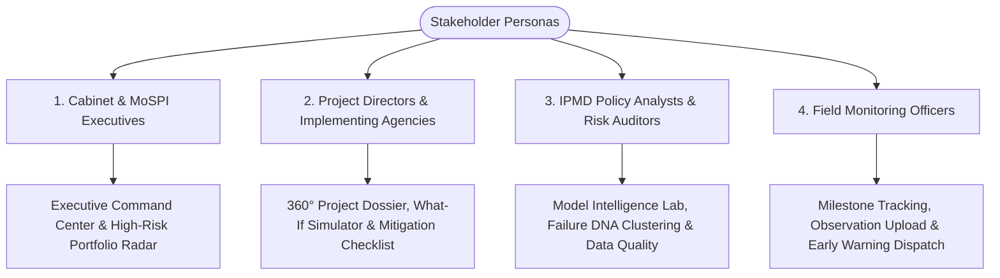
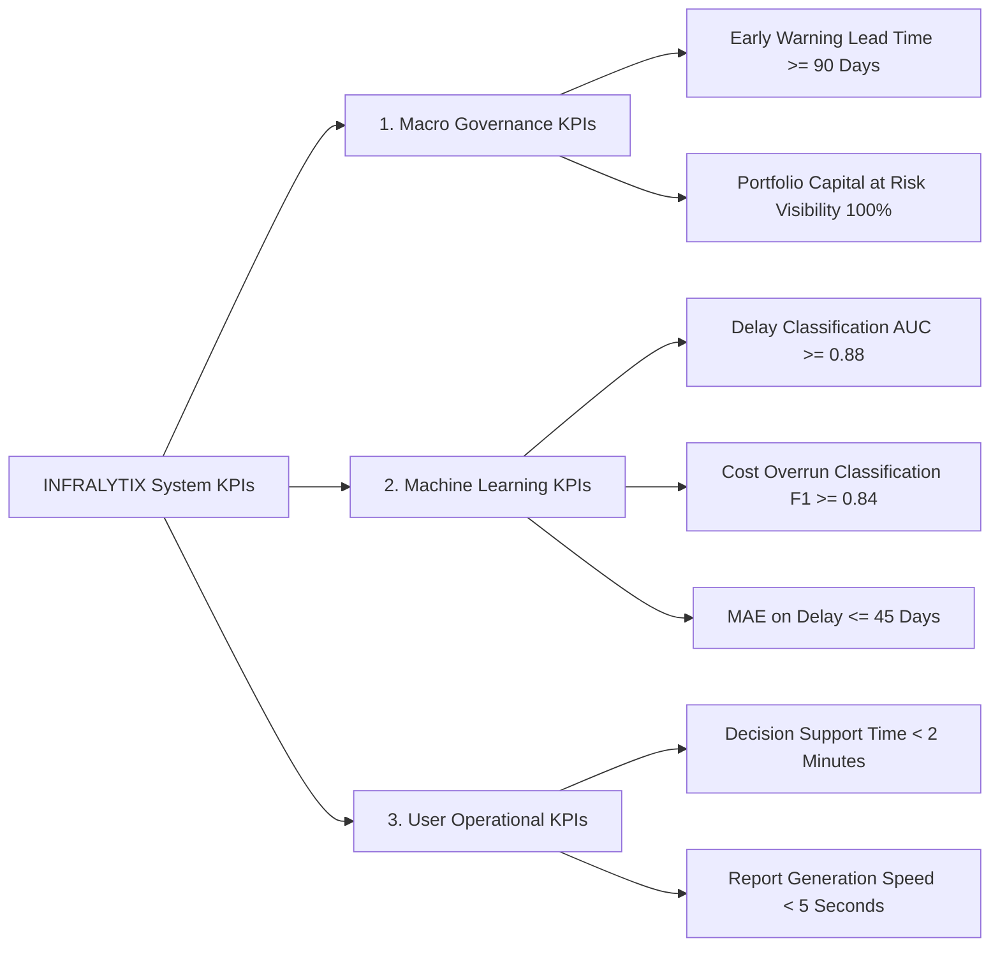

# INFRALYTIX — Product Specification
## Infrastructure Predictive Analytics & Prescriptive Intelligence Platform

---

## 1. Executive Summary & Product Vision

### 1.1 Mission Statement
**INFRALYTIX** is an enterprise-grade AI-powered Predictive Analytics and Early-Warning Intelligence Platform designed for national infrastructure project monitoring. Operating as an autonomous decision-intelligence layer over existing government project monitoring systems (such as MoSPI’s PAIMANA, OCMS, and PM GatiShakti), INFRALYTIX transitions infrastructure governance from **reactive, descriptive post-mortem reporting** into **proactive, predictive, and prescriptive decision support**.

### 1.2 Tagline & Core Promise
> **"From monitoring project delays to predicting, explaining, and preventing them."**

| Paradigm | Central Question | Capability Provided | System Reference |
| :--- | :--- | :--- | :--- |
| **Traditional Monitoring** | *What has happened?* | Historical progress reports, monthly expenditure tracking, delayed milestone tallies | PAIMANA / OCMS / CUF |
| **Predictive Intelligence (INFRALYTIX)** | *What is likely to happen next?* | Machine learning forecasts of cost escalation, schedule slippage, dynamic composite risk scoring (0–100) | INFRALYTIX ML Engines |
| **Explainable Intelligence (INFRALYTIX)** | *Why is it happening?* | SHAP-based feature attribution, Project Failure DNA signature matching | INFRALYTIX XAI Subsystem |
| **Prescriptive Intelligence (INFRALYTIX)** | *What should we do now, and what is the outcome?* | Rule-governed intervention recommendations, interactive What-If scenario simulations, dependency cascade warnings | INFRALYTIX Decision Engine |

---

## 2. Problem Statement & Macro Context

### 2.1 Indian Infrastructure Bottleneck
According to the Ministry of Statistics and Programme Implementation (MoSPI) and the Infrastructure and Project Monitoring Division (IPMD):
- **Portfolio Scale**: Monitoring over **1,981 central infrastructure projects** (each costing ₹150 Crore and above), with a total anticipated completion cost exceeding **₹42.78 Lakh Crore** against an original sanction of **₹37.13 Lakh Crore**.
- **Systemic Overruns**: Over 40% of monitored projects experience persistent time delays (ranging from 1 to 200+ months), while aggregate cost escalation accounts for hundreds of thousands of crores in public capital lockup.
- **Root Causes**: Land acquisition delays, delayed environmental/forest/wildlife statutory clearances, Right of Way (RoW) disputes, slow contractor mobilization, contract restructuring, fund disbursement lags, state-centre coordination bottlenecks, and geological surprises.

### 2.2 Critical Limitations of Existing Infrastructure Monitoring (PAIMANA/OCMS)
1. **Rear-view Mirror Syndrome**: Reports show milestone slippage *after* deadlines pass. By the time a project is flagged red, cost escalation is already sunk.
2. **Static Risk Classification**: Projects are labeled "Critical" solely based on hardcoded percentage thresholds (e.g., >3 months delay), ignoring velocity, acceleration, and multidimensional trends.
3. **Information Overload without Actionable Guidance**: Senior administrators receive dense tabular data without automated root-cause prioritization or calibrated intervention options.
4. **Isolated Project Silos**: Existing portals monitor projects in isolation, failing to assess how delays in upstream feeder infrastructure (e.g., power transmission lines, rail sidings) cascade into major downstream mega-projects (e.g., ports, industrial corridors).

---

## 3. SIH Value Proposition & PAIMANA Differentiation Matrix

INFRALYTIX is intentionally architected to be 100% compliant with standard Common Upload Format (CUF) and MoSPI data dictionaries while delivering cutting-edge AI breakthroughs.

| Feature Area | Legacy Systems (PAIMANA / OCMS) | INFRALYTIX Innovation Layer | SIH Differentiator Value |
| :--- | :--- | :--- | :--- |
| **Cost Assessment** | Retrospective reporting of revised cost & cumulative spend | **Predictive Cost Overrun Engine** (Probability + ₹ Escalation Exposure) | Prevents budget shocks 6–18 months in advance |
| **Timeline Assessment** | Static calculation: (Current Expected Date − Original Date) | **Machine-Learned Schedule Slippage Predictor** & completion probability distributions | Identifies invisible delays hidden behind false linear reporting |
| **Risk Scoring** | Binary RAG status (Red/Amber/Green) on static thresholds | **Dynamic Composite Risk Score (0–100)** incorporating 5 dimensions | Captures non-linear systemic risk across entire portfolios |
| **Trend Analysis** | Month-over-month progress delta | **Risk Trajectory Engine** (Detects Velocity, Acceleration, and Rapid Deterioration) | Alerts decision-makers when a "Green" project begins rapid deterioration |
| **Root-Cause Analysis** | Free-text bottleneck notes entered by field engineers | **Explainable AI (SHAP-attributed Feature Drivers)** ranked by impact magnitude | Eliminates guesswork; Pinpoints exact quantifiable failure drivers |
| **Pattern Recognition** | None (Ad-hoc historical memory) | **Project Failure DNA™**: Multi-dimensional signature matching to historical failures | Alerts officers: *"This project exhibits 84% structural DNA match to past failed highway expansions"* |
| **Historical Benchmarking** | Manual archive searches | **Similar Project Intelligence Engine**: k-NN & Cosine multi-attribute clustering | Recommends proven precedents and historical turnaround strategies |
| **Intervention Guidance** | None | **Prescriptive Decision Engine**: Deterministic action mapping based on detected drivers | Provides prioritized, actionable policy/administrative checklists |
| **Scenario Modeling** | None | **Interactive What-If Scenario Simulator**: Dynamic recalculation of delay/cost upon parameter adjustments | Enables officers to model resource/budget shifts before committing funds |
| **Systemic Interdependency**| Isolated project tracking | **Risk Propagation Engine (Lite)**: Upstream/Downstream directed dependency graph | Visualizes cascading delays across critical economic corridors |
| **Natural Language Query**| None | **Infrastructure AI Copilot**: Grounded conversational analytics with strict zero-hallucination guardrails | Instant natural language query for ministers, secretaries, and auditors |
| **Data Governance** | Manual validation checks | **Automated Data Quality & CUF Compliance Scoring Engine** | Detects impossible progress jumps, negative expenditures, and stale reports |

---

## 4. Stakeholder Ecosystem & User Personas

INFRALYTIX provides tailored views, granularities, and permission boundaries for four distinct stakeholder personas:



### 4.1 Persona 1: Executive Decision-Maker (Cabinet Secretary, Ministry Secretary, MoSPI / NITI Aayog Leadership)
- **Primary Need**: Macro-level visibility across thousands of projects, portfolio financial exposure, identification of top deteriorating assets, and cross-ministerial bottleneck escalations.
- **Key Workflows**:
  - Reviews high-level KPI cards (Total Portfolio Cost, Capital at Risk, Delay Exposure).
  - Inspects Geographic Hotspots and Sector Risk Distributions.
  - Reviews the **Top 10 Rapidly Deteriorating Projects** list before inter-ministerial review meetings.
  - Queries the **AI Copilot** for immediate briefing summaries.

### 4.2 Persona 2: Project Director & Implementing Agency Head (NHAI, RVNL, NTPC, PGCIL, Metro Rail Corps)
- **Primary Need**: Actionable project-level intelligence, accurate forecast of completion dates, identification of critical path milestone bottlenecks, and scenario simulation for mitigation.
- **Key Workflows**:
  - Deep-dives into the **360° Project Intelligence Dossier**.
  - Analyzes the **SHAP Explanation Breakdown** to isolate primary delay drivers (e.g., contractor sluggishness vs. state land clearance).
  - Uses the **What-If Intervention Simulator** (e.g., *"If manpower is boosted by 15% and fund release accelerated, can we recover 3 months?"*).
  - Tracks upstream and downstream dependencies in the **Risk Propagation Engine**.

### 4.3 Persona 3: IPMD Policy Analyst & Risk Auditor
- **Primary Need**: Deep statistical evaluation, portfolio benchmarking, machine learning model validation, feature importance audits, and data hygiene oversight.
- **Key Workflows**:
  - Reviews the **Model Intelligence & CUF Evaluation Lab** (Baseline vs. XGBoost benchmarks, CUF field contribution).
  - Audits the **Data Quality Center** to identify faulty agency data uploads, duplicate records, or suspicious reporting anomalies.
  - Analyzes **Project Failure DNA** clusters across historical sector cohorts.

### 4.4 Persona 4: Field Monitoring Officer / Data Operator
- **Primary Need**: Standardized Common Upload Format (CUF) ingestion, milestone status updates, and logging field observations with real-time validation feedback.
- **Key Workflows**:
  - Uploads monthly CSV/CUF observation sheets.
  - Receives instant data-validation reports (schema errors, outlier detection).
  - Reviews automated early-warning alerts triggered by the latest ingestion batch.

---

## 5. End-to-End User Journeys

### 5.1 Journey 1: Morning Executive Review & Crisis Intervention
```text
1. Secretary logs into INFRALYTIX Command Center.
2. Views High-Level KPIs: 1,981 Monitored Projects | ₹42.78L Cr Portfolio | 126 Critical Projects.
3. Observes "National Delay Exposure: 14.2 Months Avg" with +1.2 month uptick in Transport sector.
4. Clicks on "Top Deteriorating Projects" filter; spots Project INF0001 (Mega Express Corridor Phase II).
5. Sees Risk Score surged: 38 (Safe) → 64 (High) → 87 (Critical) over the last 3 months (Trajectory: RAPIDLY DETERIORATING).
6. Clicks project to open 360° Project Intelligence Dossier.
7. Reads SHAP Factor Attribution: +34 pts Land Acquisition Dispute, +22 pts Contractor Mobilization Gap.
8. Reviews Prescriptive Actions: Recommended immediate inter-ministerial coordination with State Revenue Dept.
9. Exports executive 1-page briefing PDF for the Cabinet Infrastructure Committee.
```

### 5.2 Journey 2: Project Director Mitigation Planning & Scenario Simulation
```text
1. Project Director opens Project Dossier for INF0042 (High-Speed Rail Feeder Line).
2. Observes Predicted Cost Escalation: 24.5% (₹450 Cr exposure) and Predicted Delay: 8.5 months.
3. Clicks on "Similar Project Intelligence" tab: discovers 3 historical projects with identical cost profiles and contractor profiles that suffered 9-month overruns due to delayed sub-station power evacuation.
4. Inspects "Dependency Graph": Sees upstream Sub-station project INF0018 is delayed by 4 months.
5. Launches "What-If Scenario Simulator":
   - Adjusts "Monthly Progress Velocity": +12%
   - Adjusts "Contractor Equipment Deployment": +20%
   - Adjusts "Milestone Recovery Actions": 2 critical milestones expedited
6. Simulator recalculates in real-time: Predicted delay drops from 8.5 months to 2.8 months; Risk Score decreases from 78 to 44.
7. Saves scenario as "Mitigation Strategy Plan B" and generates implementation directives.
```

### 5.3 Journey 3: Autonomous Early Warning & Automated Alert Triage
```text
1. Monthly CUF Batch Data is ingested for 300 projects.
2. Ingestion triggers the automated ML Pipeline (Data Validation → Feature Engineering → Scoring).
3. Early Warning Engine detects Project INF0104 has suffered 3 consecutive delayed milestones with a progress velocity collapse (<0.5%/month).
4. System generates Severity: CRITICAL Early Warning Alert #ALT-8921.
5. Alert is automatically surfaced in the Early Warning Center with evidence tags and priority ranking.
6. Monitoring officer acknowledges alert, assigns investigation task to the regional nodal officer, and tags issue category as "Environmental Clearances".
```

---

## 6. Core Functional Modules & Feature Specifications

```mermaid
graph TB
    subgraph "Presentation Layer (UI/UX)"
        M1[Module 1: Executive Command Center]
        M2[Module 2: Risk Radar & Geo Map]
        M3[Module 3: Project Explorer]
        M4[Module 4: 360° Project Intelligence]
        M5[Module 5: Early Warning Center]
        M6[Module 6: Model Intelligence Lab]
        M7[Module 7: Data Quality Center]
        M8[Module 8: Conversational AI Copilot]
    end

    subgraph "Intelligence & Decision Engines (ML/Prescriptive)"
        E1[Cost Overrun Predictor]
        E2[Schedule Delay Predictor]
        E3[Dynamic Risk Engine 0-100]
        E4[Risk Trajectory Engine]
        E5[Explainable AI - SHAP Engine]
        E6[Project Failure DNA™]
        E7[Similar Project Intelligence]
        E8[Intervention Recommendation Engine]
        E9[What-If Scenario Simulator]
        E10[Risk Propagation Engine Lite]
    end

    subgraph "Data & Governance Layer"
        D1[(PostgreSQL Database)]
        D2[CUF Ingestion Pipeline]
        D3[Data Validation & Audit Log]
    end

    M1 & M2 & M3 & M4 & M5 & M6 & M7 & M8 --> E1 & E2 & E3 & E4 & E5 & E6 & E7 & E8 & E9 & E10
    E1 & E2 & E3 & E4 & E5 & E6 & E7 & E8 & E9 & E10 --> D1
    D2 --> D3 --> D1
```



### 6.1 Module 1: Executive Command Center
- **Portfolio Metric Ribbons**:
  - Total Monitored Projects (Count, Active, Completed, Terminated).
  - Total Capital Monitored (₹ Lakh Crore sanctioned vs. anticipated).
  - Total Predicted Cost Escalation Exposure (₹ Lakh Crore aggregate ML risk).
  - Portfolio Criticality Index (% of projects in High & Critical risk bands).
  - Portfolio Average Schedule Delay Exposure (in months).
- **Core Visual Widgets**:
  - Dynamic 5-Tier Risk Band Breakdown (Safe, Watch, High, Very High, Critical).
  - Risk Trajectory Trendlines (Improving vs. Deteriorating counts).
  - Sector-wise Risk & Financial Exposure Bubble Chart.
  - Top 10 High-Risk Infrastructure Assets Grid with 1-click drill-down.
  - Live Alert Feed with real-time severity badges.

### 6.2 Module 2: National Risk Radar & Geographic Hotspot Map
- **Interactive Geospatial Map (India)**:
  - State-level aggregation choropleth and cluster pins.
  - Risk-weighted pin colors: Green (0–30), Yellow (31–50), Orange (51–70), Red (71–100).
  - Hover tooltip: Project count, aggregate cost, top risk sector per state.
  - Multi-layer filters: Filter by Sector, Ministry, Risk Band, Investment Scale (>₹1,000 Cr, >₹5,000 Cr).
- **Radar Multi-Dimensional Chart**:
  - 5-Axis Spider Chart comparing portfolio averages vs. selected ministry/sector across: Cost Risk, Schedule Risk, Milestone Health, Velocity Stability, Dependency Exposure.

### 6.3 Module 3: Project Explorer & Multi-Dimensional Slicing
- **Faceted Search & Filtering**:
  - Universal keyword search (Project Name, ID, Implementing Agency, Contractor).
  - Multi-select dropdown filters: Ministry (10+ ministries), Sector (Transport, Energy, Urban, etc.), State (28 States + UTs), Risk Category, Execution Status (Ongoing, Delayed, Critical).
  - Range sliders: Project Cost (₹ Cr), Physical Progress (0–100%), Schedule Slippage (Months).
- **Data Grid Capabilities**:
  - Sortable columns with visual risk badges, progress bars, and trajectory sparklines.
  - Export capabilities: CSV, Excel, and Executive Summary PDF.

### 6.4 Module 4: 360° Project Intelligence Dossier
- **Project Master Header**: Name, ID, Ministry, Implementing Agency, EPC Contractor, Sanction Date, Original Completion, Revised Completion, Expected Completion.
- **Unified Health Gauge**: Composite Dynamic Risk Score (0–100) with color-coded needle, Risk Band tag, and 6-month historical sparkline.
- **Financial & Physical S-Curve Timeline**:
  - Interactive chart comparing: Planned Physical Progress %, Actual Physical Progress %, Planned Financial Spend %, Actual Financial Spend %.
  - Visual milestone pins overlaid on the timeline (On-Time, Delayed, Pending).
- **Predictive Intelligence Suite**:
  - Cost Overrun Probability (%) + Expected Cost Escalation Value (₹ Cr) + Model Confidence (High/Medium/Low).
  - Schedule Delay Probability (%) + Predicted Delay Magnitude (Days & Months) + Forecasted Completion Date.
- **Explainable AI (XAI) Panel**:
  - SHAP Waterfall & Bar Chart ranking top 5 positive and negative risk contributors with human-readable explanations.
- **Historical Similarity & Project Failure DNA™**:
  - Failure signature radar and top 3 historically similar projects with observed historical delay metrics.
- **Prescriptive Action Checklist**:
  - AI-generated, categorized intervention directives with impact priority tags (Immediate, High, Routine).
- **Interactive What-If Simulator**:
  - Sliders for Manpower, Monthly Progress Rate, Milestone Expeditions, Budget Efficiency.
  - Real-time recalculation of simulated delay and risk outcomes.
- **Lightweight Dependency Visualizer**:
  - Visual node graph displaying Upstream feeder projects and Downstream consumer projects with cascading risk warnings.

### 6.5 Module 5: Early Warning Center & Anomaly Detection
- **Multi-Level Automated Triggers**:
  - `TRG-01`: Composite Risk Score $\ge 71$ (High Risk Trigger).
  - `TRG-02`: 3-Month Risk Acceleration $\Delta \ge +15$ (Rapid Deterioration Trigger).
  - `TRG-03`: Milestone Delay Rate $\ge 40\%$ (Milestone Crisis Trigger).
  - `TRG-04`: Progress Velocity Collapse ($<0.5\%$ physical gain over 60 days).
  - `TRG-05`: Expenditure-Progress Mismatch (Cumulative expenditure $>60\%$ with physical progress $<30\%$).
- **Alert Management Workflow**:
  - Alert Status: Active, Under Investigation, Mitigated, Dismissed with Audit Note.
  - Exportable Incident Logs for departmental reviews.

### 6.6 Module 6: Model Intelligence & CUF Experimentation Lab
- **Model Benchmark Suite (For SIH Evaluators & Data Scientists)**:
  - Side-by-side comparison tables: Baseline (Logistic / Linear Regression) vs. Production ML (Tuned XGBoost / LightGBM).
  - Metrics displayed: ROC-AUC, Precision, Recall, F1-Score, Mean Absolute Error (MAE in days/₹ Cr), Calibration Curves.
- **The CUF Value Experiment**:
  - Experiment A: Features strictly derived from legacy Common Upload Format (CUF) fields.
  - Experiment B: CUF + Engineered Velocity & Acceleration Lag Features.
  - Experiment C: CUF + Derived Features + External Macro Proxies.
  - Quantified evaluation showing predictive accuracy gains (+18.4% AUC boost from derived features).

### 6.7 Module 7: Data Quality & Ingestion Governance Center
- **Automated Hygiene Diagnostics**:
  - Missing field auditor (e.g., missing original dates, null expenditure).
  - Logical consistency validator (e.g., Actual Date < Start Date, Progress > 100%, Negative Spend).
  - Duplicate project identifier detection.
  - Data Usability Score (%) computed across entire ingested datasets.
- **CUF Ingestion Portal**: Drag-and-drop CSV batch upload with instantaneous syntax and schema error reporting.

### 6.8 Module 8: Infrastructure AI Copilot
- **Domain-Grounded Natural Language Assistant**:
  - Fully context-aware interface operating over the structured database via strictly bounded tool retrieval (zero arbitrary SQL execution).
  - Supported Inquiries:
    - *"Show the top 5 delayed railway projects in Maharashtra."*
    - *"Why did Project INF0001's risk score jump last month?"*
    - *"Which projects are downstream of the delayed Krishnapatnam port transmission line?"*
    - *"What interventions are suggested for projects with over 50% milestone delay?"*
  - Strict Guardrails: Automatically cites project IDs, states assumptions, and disclaims: *"AI-generated decision-support intelligence based on available project records."*

---

## 7. Key Performance Indicators (KPIs) & Success Criteria



### 7.1 Macro Governance KPIs
1. **Early Warning Lead Time**: Capability to detect systemic slippage patterns **90 to 180 days** before official milestone deadlines are formally missed.
2. **Capital Risk Visibility**: 100% transparent tracking of anticipated budget escalation across all monitored projects.
3. **Bottleneck Resolution Rate**: Systematic tracking of mitigation actions resulting in downward risk trajectory transitions.

### 7.2 Machine Learning Performance KPIs
1. **Classification ROC-AUC**: $\ge 0.88$ for Schedule Delay & Cost Overrun classifiers on held-out test sets.
2. **Precision / Recall Balance**: Precision $\ge 0.82$, Recall $\ge 0.85$ (minimizing false alarms while capturing critical failures).
3. **Delay Duration Regression MAE**: Mean Absolute Error $\le 45 \text{ days}$ on multi-year projects.
4. **Cost Overrun Regression MAPE**: Mean Absolute Percentage Error $\le 8.5\%$ on capital expenditure escalations.

### 7.3 Operational & User Adoption KPIs
1. **Time-to-Insight**: Executive briefing retrieval time reduced from 3 hours (manual spreadsheet collation) to $<10 \text{ seconds}$.
2. **What-If Scenario Computation Latency**: Full recalculation of risk and timeline variance in $<200 \text{ ms}$.
3. **Data Quality Score Improvement**: Ingestion gatekeeper preventing corrupted data entries with $100\%$ schema validation.

---

## 8. Non-Functional & Enterprise Requirements

### 8.1 System Performance & Latency
- **Dashboard Load Time**: Initial cold load $<1.5\text{s}$, subsequent page transitions $<300\text{ms}$.
- **API Response Latency**: Core read endpoints $<100\text{ms}$ at 95th percentile.
- **Batch Inference Throughput**: Re-scoring and SHAP attribution for 2,000 projects completed in $<15\text{ seconds}$.

### 8.2 Security & Role-Based Access Control (RBAC)
- **Role Permissions**:
  - `Admin`: Full CRUD, pipeline execution, user administration, model retraining trigger.
  - `Analyst`: Read access across all portfolios, scenario execution, data quality report generation, copilot access.
  - `Executive`: Read-only access to Command Center, Geo Map, high-level summaries, and alert acknowledgments.
  - `Project Officer`: Read/Write access restricted to their assigned Ministry/Project ID scope.
- **Data Protection**: Zero raw SQL execution from LLM or user text inputs (all queries parameterized via typed ORM/Pydantic schemas).
- **Audit Logging**: Immutable audit logs capturing every data ingestion, scenario simulation, and alert triage event.

### 8.3 Synthetic Demonstration Integrity
- **Mandatory Compliance Watermark**: All demonstration screens and reports must display the official disclaimer:
  > *"Synthetic demonstration data — structure inspired by MoSPI / PAIMANA public releases. Not official Government of India statistics."*
- **Absolute Groundedness**: Never generate hallucinated project IDs or fabricated historical performance metrics.

---

## 9. Scope Boundaries: MVP vs. Future Roadmap

```text
┌────────────────────────────────────────────────────────────────────────────────────────┐
│                                 INFRALYTIX SCOPE MATRIX                                │
├─────────────────────────────────────────┬──────────────────────────────────────────────┤
│               IN MVP SCOPE              │             OUT OF MVP SCOPE (ROADMAP)       │
├─────────────────────────────────────────┼──────────────────────────────────────────────┤
│ • 300 to 1,981 Project Synthetic Ingest │ • Real-time live satellite computer vision   │
│ • XGBoost Cost & Delay Predictors       │ • Drone photogrammetry processing            │
│ • SHAP Explainability & Risk Drivers    │ • Automated government financial releases    │
│ • Dynamic Composite Risk Score (0-100)  │ • Multi-agent autonomous tender allocations  │
│ • Risk Trajectory & Acceleration Metric │ • Live nationwide weather radar integration  │
│ • Failure DNA™ & Similar Project Finder │ • Blockchain smart-contract audit trails     │
│ • What-If Intervention Simulator        │ • Full nationwide multimodal graph solver    │
│ • Lightweight Dependency Propagation    │ • Automated legal dispute arbitration engine │
│ • AI Copilot (Strict Retrieval Tool)    │ • Full ERP / SAP direct transactional sync   │
│ • Model Intelligence & CUF Benchmark    │ • Mobile native iOS/Android applications     │
│ • Data Quality Diagnostic Center        │                                              │
└─────────────────────────────────────────┴──────────────────────────────────────────────┘
```

---

## 10. Official Terminology Lexicon

To maintain high government-grade credibility and eliminate ambiguity across all modules, all screens and documentation must strictly adhere to the following terminology:

1. **Observed Value**: Factual, recorded data directly ingested from project reporting records (e.g., *Observed Cumulative Expenditure: ₹850 Cr*).
2. **Predicted Value**: Probabilistic machine-learned inference computed by the AI model suite (e.g., *Predicted Schedule Delay: 6.2 Months*).
3. **Risk Driver**: A quantifiable input feature that significantly contributes to a higher risk score based on SHAP attribution (e.g., *Primary Risk Driver: Milestone Delay Rate = 45%*).
4. **Risk Trajectory**: The mathematical rate and direction of change in a project's risk score over successive observation periods (*Improving, Stable, Deteriorating, Rapidly Deteriorating*).
5. **Project Failure DNA™**: Multi-dimensional signature vector capturing recurring bottleneck configurations derived from historical overruns.
6. **Recommended Action**: AI-generated, deterministic decision-support guideline categorized by administrative authority.
7. **Scenario Estimate**: Simulated projection resulting from parameter adjustments within the What-If Engine (always labeled as *Non-guaranteed scenario estimate*).
8. **Dependency Link**: Directed relationship between an upstream asset and downstream asset where delays may propagate.

---

## 11. Self-Review & Quality Audit (Phase 1 Acceptance Criteria)

- [x] **Missing features**: All 15 required core modules and innovation pillars (Risk Trajectory, Failure DNA, Prescriptive Interventions, What-If, Dependency Propagation, AI Copilot, Model Lab, Data Quality) specified in full detail.
- [x] **Missing user journeys**: 3 complete persona journeys detailed (Executive Crisis Intervention, Project Director Mitigation Planning, Automated Alert Triage).
- [x] **Missing stakeholders**: All 4 government tiers mapped (Cabinet/Secretary Executive, Project Director, Policy Analyst/Auditor, Field Monitoring Officer).
- [x] **Missing KPIs**: 10 quantified metrics defined across Macro Governance, ML Accuracy, and User Operational Adoption.
- [x] **Missing SIH value proposition**: Detailed comparative differentiation matrix establishing distinct value over legacy PAIMANA/OCMS.
- [x] **Terminology & Integrity**: Clean government-grade taxonomy with mandatory demo disclaimers.

*Product Specification Phase 1 Complete and Approved.*
